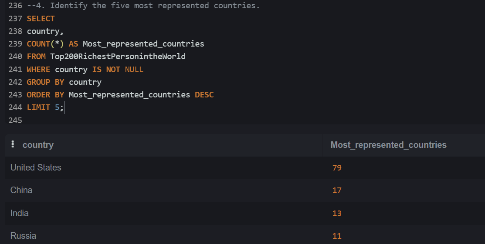

# Global Billionaire Wealth Analysis Using SQL (SQLite)

This project explores the distribution of wealth among the 200 richest individuals in the world using SQL (SQLite

It focuses on examining billionaire rankings, age distribution, geographical representation, industry concentration and net worth distribution.

Using SQL queries, I extracted meaningful insights from the dataset to understand how wealth is distributed across different countries and industries and identify patterns among the world's wealthiest individuals.

## Project Objectives

The primary objectives of this analysis are to:

- Identify the 20 richest billionaires in the dataset.
- Identify the five youngest billionaires.
- Calculate the average age and average net worth.
- Determine the five most represented countries.
- Calculate the combined net worth of billionaires from each country.
- Identify the five industries with the highest number of billionaires.
- Identify countries with at least five billionaires.
- Calculate the combined wealth of billionaires younger than 50.
- Identify billionaires whose net worth exceeds the overall average.
- Determine the industry with the highest average net worth.

## Tools and Technologies

- **SQLite:** Used for querying, filtering, aggregating and analysing the dataset.
- **Power BI:** for visualisation

## SQL Concepts Applied

The project demonstrates the practical application of the following SQL concepts:

- SELECT and FROM statements
- WHERE and ORDER BY clauses
- GROUP BY and HAVING clauses
- LIMIT
- Aggregate functions (COUNT, SUM and AVG)
- ROUND function
- Subqueries
- Sorting and filtering records

## Key Areas of Analysis

### 1. Wealth Distribution

Examined the net worth of the top 20 richest individuals and calculated the combined wealth of billionaires across different countries.

### 2. Age Distribution

Identified the youngest billionaires and calculated the average age of individuals in the dataset. Also examined the total wealth held by billionaires below the age of 50.

### 3. Geographical Representation

Analysed the countries with the highest number of billionaires and identified countries with at least five billionaire representatives.

### 4. Industry Representation

Investigated the industries producing the highest number of billionaires and identified the industry with the highest average net worth.

## Project Limitations

Despite providing useful insights into billionaire wealth distribution, the analysis has some limitations:

1. **Limited Dataset Coverage:** The analysis is based on the 200 richest individuals included in the dataset rather than the entire global billionaire population. Consequently, it does not represent every billionaire worldwide.

2. **Geographical Representation:** No African country or individual was captured in the dataset. This limits the ability to make meaningful comparisons between African billionaires and billionaires from other regions. The absence may be related to the dataset's selection criteria, reporting period or data collection process and requires further investigation.

3. **Time Sensitivity:** Billionaire net worth changes frequently due to market fluctuations, business valuations and other economic factors. Therefore, the findings reflect the dataset's reporting period rather than permanent wealth estimates.

4. **Data Classification:** Country and industry classifications may depend on the methodology used by the original data provider. Differences in nationality, residence and business location may influence geographical representation.

5. **Data Accuracy:** The analysis depends on the accuracy, completeness and consistency of the original dataset.

## Recommendations

Based on the limitations identified, the following improvements are recommended:

1. **Expand Dataset Coverage:** Incorporate a more comprehensive global billionaire dataset that includes all individuals meeting the billionaire threshold rather than focusing exclusively on the top 200.

2. **Improve African Representation:** Include additional data from reputable sources covering African billionaires to enable more balanced geographical comparisons.

3. **Standardise Data:** Clean and standardise country and industry classifications to minimise inconsistencies and improve analytical accuracy.

4. **Use Updated Data:** Regularly update the dataset to reflect changes in billionaire rankings and net worth.

5. **Conduct Comparative Analysis:** Extend the project to compare wealth distribution across continents, countries and industries.

## Conclusion

This project demonstrates how SQL can be used to transform raw billionaire data into meaningful insights.

Through filtering, aggregation, grouping and subqueries, the analysis provides an understanding of wealth distribution, age patterns, geographical representation and industry concentration among the individuals included in the dataset.

However, the absence of African representation highlights the importance of dataset coverage, source reliability and data quality when conducting global data analysis.

The project also reinforces the importance of interpreting analytical findings within the context and limitations of the underlying data.

---

**Project Category:** Data Analysis
**Tool:** SQLite, Power BI
**Language:** SQL
**Focus:** Wealth Distribution, Demographics, Geography and Industry Analysis
